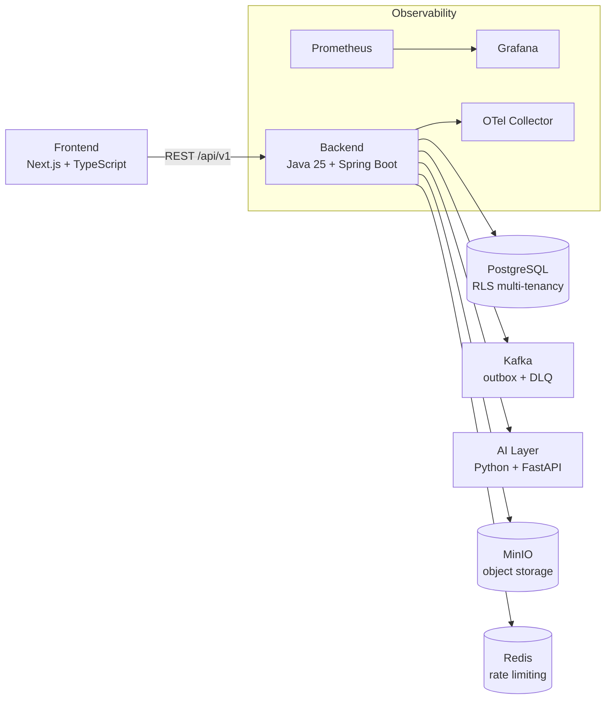

# AI-Native Workflow Automation Platform (AWAP)

**Design, run and optimize business processes — visually, reliably and with AI.**

AWAP is a no-code workflow automation platform. Teams model business
processes once in a visual designer, and the platform takes care of the rest:
intelligent task routing, approvals, forms, deadlines, audit trails and agentic AI
assistance. It replaces manual, email-driven and spreadsheet-based processes with a
single, auditable system of record.

---

## What AWAP does

AWAP digitizes operational processes end to end:

| Capability | Description |
|---|---|
| **No-code workflow designer** | Drag-and-drop process modeling with `START`, `FORM`, `APPROVAL`, `TASK` and `END` nodes, draft/publish, versioning and rollback. |
| **Forms with validation** | Text, number, email, phone, date, boolean, select, multi-select and file fields with required/min-max/regex/server-side validation. |
| **Tasks & approvals** | Assign, claim, approve, reject, reassign and escalate tasks, with optimistic locking and double-approval protection. |
| **Organizational model** | Company → Department → Team → User hierarchy with position-based roles, mirrored automatically into workflow routing. |
| **Multi-tenancy** | Shared database with PostgreSQL row-level security; every request is tenant-scoped and isolated. |
| **Enterprise security** | JWT authentication with rotating refresh tokens, RBAC permissions, CSRF protection, HttpOnly cookies, rate limiting, ClamAV file scanning and Vault-backed secrets. |
| **Event-driven engine** | Transactional outbox to Kafka with DLQ and retry, so workflow events are delivered reliably and in order. |
| **Agentic AI layer** | A FastAPI service ready for LangChain/LangGraph agents that can execute AI steps inside workflows. |
| **Observability** | Prometheus metrics, OpenTelemetry tracing, structured JSON logs with correlation IDs, and Grafana dashboards. |

---

## Architecture

AWAP is a modular monorepo with three runtime layers connected by a REST API and an
event bus.



| Layer | Responsibility | Stack |
|---|---|---|
| `backend/` | Identity, organization, workflow definitions, engine, tasks, forms, files | Java 25, Spring Boot 4.1.1, Maven |
| `frontend/` | Workflow designer, form builder, task/approval screens, admin | Next.js 16, TypeScript 7.0.2, TanStack Query, React Flow, Tailwind |
| `ai-layer/` | AI execution and agentic steps | Python 3.15.0, FastAPI, LangChain/LangGraph |
| `infra/` | Local stack, Kubernetes manifests, observability | Docker Compose, Kafka + Schema Registry, PostgreSQL, MinIO, OpenSearch, Vault, Prometheus, Grafana |

The authoritative compatibility matrix is maintained in
[`COMPATIBILITY.md`](COMPATIBILITY.md).

---

## Repository layout

```
.
├── backend/       # Java 25 + Spring Boot 4.1.1 (Maven multi-module: common, identity)
├── frontend/      # Next.js 16 + TypeScript (pnpm)
├── ai-layer/      # Python + FastAPI (agentic AI execution)
├── infra/         # Docker Compose, Kubernetes manifests, observability
├── docs/          # intent, spec, Architecture Decision Records
├── .github/       # CI/CD workflows, PR template, Dependabot
└── COMPATIBILITY.md
```

---

## Getting started

### Prerequisites

- JDK 25 (Temurin)
- Node.js 24 LTS + pnpm
- Python 3.15.0 (uv) for the AI layer
- Docker + Docker Compose for local infrastructure

### 1. Start local infrastructure

```bash
cd infra
docker compose up -d
```

Starts PostgreSQL, Redis, Kafka (+ Schema Registry), OpenSearch, Vault,
Prometheus, Grafana and the OpenTelemetry collector. MinIO is opt-in (its public
Docker image now requires authentication or building from source); start it with
`docker compose --profile storage up -d minio`.

### 2. Run the backend

```bash
cd backend
./mvnw verify
./mvnw -pl identity spring-boot:run
```

### 3. Run the frontend

```bash
cd frontend
pnpm install
pnpm dev
```

### 4. Run the AI layer

```bash
cd ai-layer
uv sync --locked
uv run uvicorn app.main:app --reload
```

---

## Quality gates

Every pull request passes automated checks: build and tests, ArchUnit/Checkstyle/
ESLint/Ruff static analysis, OWASP and Trivy vulnerability scans, Pact contract
tests, coverage gates and SBOM generation.

---

## Documentation

- [`docs/intent.md`](docs/intent.md) — product intent and goals
- [`docs/spec.md`](docs/spec.md) — technical specification
- [`docs/adr/`](docs/adr/) — Architecture Decision Records
- [`CLAUDE.md`](CLAUDE.md) — project constitution (binding rules)

## License

[MIT](LICENSE)
