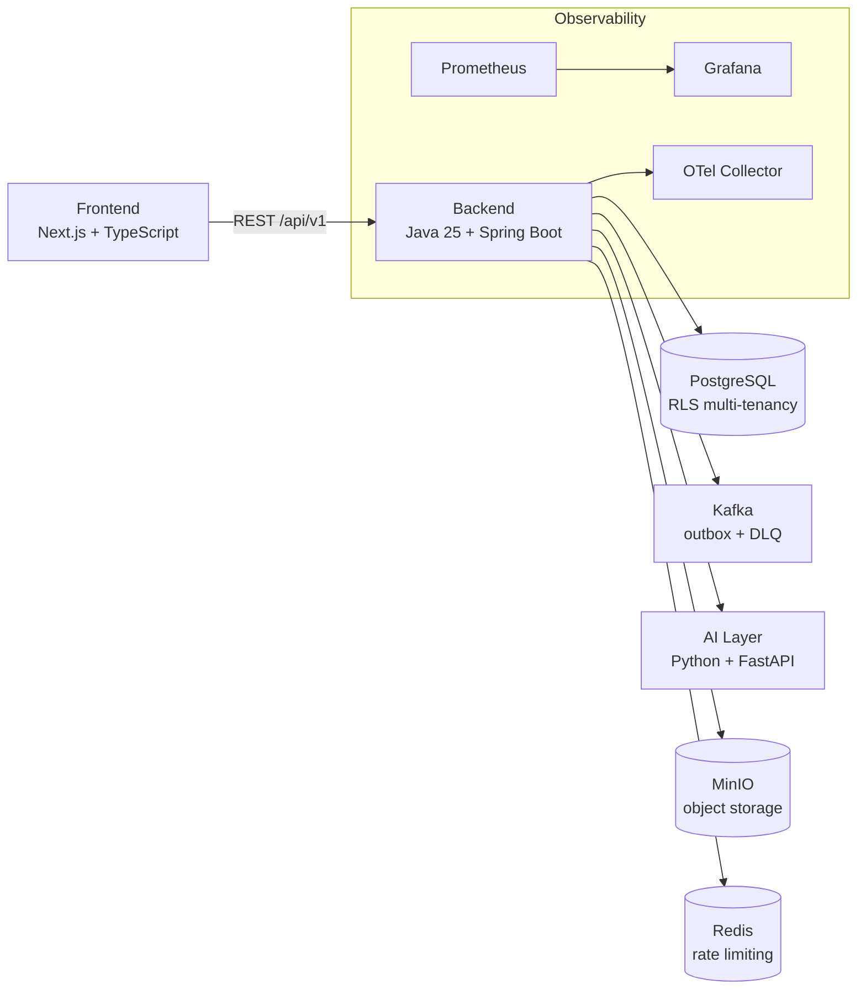

# AI-Native Workflow Automation Platform (AWAP)

**Design, run and optimize business processes — visually, reliably and with AI.**

AWAP is a no-code workflow automation platform. Teams model business
processes once in a visual designer, and the platform takes care of the rest:
intelligent task routing, approvals, forms, deadlines, audit trails and agentic AI
assistance. It replaces manual, email-driven and spreadsheet-based processes with a
single, auditable system of record.

---

## What AWAP does

AWAP digitizes operational processes end to end:

| Capability | Description |
|---|---|
| **No-code workflow designer** | Drag-and-drop process modeling with `START`, `FORM`, `APPROVAL`, `TASK` and `END` nodes, draft/publish, versioning and rollback. |
| **Forms with validation** | Text, number, email, phone, date, boolean, select, multi-select and file fields with required/min-max/regex/server-side validation. |
| **Tasks & approvals** | Assign, claim, approve, reject, reassign and escalate tasks, with optimistic locking and double-approval protection. |
| **Organizational model** | Company → Department → Team → User hierarchy with position-based roles, mirrored automatically into workflow routing. |
| **Multi-tenancy** | Shared database with PostgreSQL row-level security; every request is tenant-scoped and isolated. |
| **Enterprise security** | JWT authentication with rotating refresh tokens, RBAC permissions, CSRF protection, HttpOnly cookies, rate limiting, ClamAV file scanning and Vault-backed secrets. |
| **Event-driven engine** | Transactional outbox to Kafka with DLQ and retry, so workflow events are delivered reliably and in order. |
| **AI layer scaffold** | A FastAPI health/readiness service. LangChain/LangGraph are pinned and compatibility-tested, but no agent or AI execution endpoint exists yet. |
| **Observability** | Prometheus metrics, OpenTelemetry tracing, structured JSON logs with correlation IDs, and Grafana dashboards. |

---

## Architecture

AWAP is a modular monorepo with three runtime layers connected by a REST API and an
event bus.



| Layer | Responsibility | Stack |
|---|---|---|
| `backend/` | Identity, organization, workflow definitions, engine, tasks, forms, files | Java 25, Spring Boot 4.1.1, Maven |
| `frontend/` | Workflow designer, form builder, task/approval screens, admin | Next.js 16, TypeScript 7.0.2, TanStack Query, React Flow, Tailwind |
| `ai-layer/` | Health/readiness contract; future AI execution | Python 3.15.0, FastAPI, pinned LangChain/LangGraph |
| `infra/` | Local stack, Kubernetes manifests, observability | Docker Compose, Kafka + Schema Registry, PostgreSQL, MinIO, OpenSearch, Vault, Prometheus, Grafana |

The authoritative compatibility matrix is maintained in
[`COMPATIBILITY.md`](COMPATIBILITY.md).

---

## Repository layout

```
.
├── backend/       # Java 25 + Spring Boot 4.1.1 (Maven multi-module: common, identity)
├── frontend/      # Next.js 16 + TypeScript (pnpm)
├── ai-layer/      # Python + FastAPI (health/readiness contract today)
├── infra/         # Docker Compose, Kubernetes manifests, observability
├── docs/          # intent, spec, Architecture Decision Records
├── .github/       # CI/CD workflows, PR template, Dependabot
└── COMPATIBILITY.md
```

---

## Getting started

### Prerequisites

- Docker + Docker Compose (recommended; no local JDK/Node/Python needed)
- For local development only: JDK 25 (Temurin), Node.js 24 LTS + pnpm, Python 3.15.0 (uv)

### Quick start (one command)

```bash
cp infra/.env.example infra/.env   # optional; local defaults are safe
make up
```

`make up` runs the `full` Compose profile, which starts **every** runtime
dependency and application: PostgreSQL, Redis, Kafka + Schema Registry, MinIO,
ClamAV, OpenSearch, Vault, Prometheus, Grafana, the OpenTelemetry collector, the
fake webhook used by the E2E suite, the backend, the frontend and the AI layer.
MinIO, ClamAV and the AI layer are enabled by this profile, and the backend
enables Kafka, MinIO, ClamAV, OpenSearch and AI integrations. The command then:

1. fails early on a host-port conflict;
2. waits for every healthcheck with bounded retries and a named error;
3. runs idempotent provisioning for buckets (`minio-init`), Kafka topics
   (`kafka-init`) and the Debezium outbox connector (`debezium-init`);
4. seeds the local tenant and verifies login.

| Target | What it does |
|---|---|
| `make up` | Start the full stack, wait, provision and seed. |
| `make up-minimal` | Start only PostgreSQL, Redis, Kafka, Schema Registry, backend and frontend. |
| `make down` | Stop the full stack; volumes are kept. |
| `make reset` | Remove volumes (stale-state recovery) and start a clean seeded stack. |
| `make seed` | Idempotently create the local tenant and verify login. |
| `make provision` | Idempotently create buckets, Kafka topics and the Debezium connector. |
| `make logs` / `make ps` / `make config` | Inspect the running stack. |

| Service | URL |
|---|---|
| Frontend | http://localhost:3000 |
| Backend (REST + actuator) | http://localhost:8080 |
| AI layer | http://localhost:8000/api/v1/health |
| Fake webhook (E2E control/requests) | http://localhost:9099 |
| MinIO (API / console) | http://localhost:9000 / http://localhost:9001 |
| Grafana | http://localhost:3001 |
| Prometheus | http://localhost:9090 |
| Schema Registry | http://localhost:8081 |
| Debezium Connect | http://localhost:8083 |

Limitations and resource requirements:

- The full profile needs roughly **8 GB of free RAM** and 10 GB of disk. Use
  `make up-minimal` on smaller laptops.
- The first run downloads ClamAV signatures and builds three images, so it takes
  several minutes. Later starts reuse the cached layers and volumes.
- All credentials in `infra/.env.example` are local-only placeholders. Never
  commit a real secret; production uses Vault/External Secrets.
- The full profile pulls the Bitnami legacy MinIO image
  (`bitnamilegacy/minio`), because MinIO's upstream `quay.io` images now require
  authentication. Override `MINIO_IMAGE`/`MINIO_CLIENT_IMAGE` if you mirror a
  different MinIO build.
- Flyway applies database migrations automatically inside the backend container.

Direct Compose use is still supported:

```bash
docker compose -f infra/docker-compose.yml --profile full up -d --build
docker compose -f infra/docker-compose.yml --profile full down -v
```

### Local development (manual)

Run only the databases and brokers in Docker, and each application layer outside
Docker when iterating on code:

```bash
# 1. Databases / brokers
cd infra
docker compose up -d postgres redis kafka schema-registry

# 2. Backend
cd ../backend
./mvnw verify
DB_URL=jdbc:postgresql://localhost:5432/awap DB_USER=awap DB_PASSWORD=awap \
  ./mvnw -pl identity spring-boot:run

# 3. Frontend
cd ../frontend
pnpm install
pnpm dev

# 4. AI layer
cd ../ai-layer
uv sync --locked
uv run uvicorn app.main:app --reload
```

---

## AI layer capabilities

The AI layer is intentionally small today. The table below is the single
capability truth; the versioned contract is
[`docs/openapi/ai-layer-openapi.yaml`](docs/openapi/ai-layer-openapi.yaml).

| Capability | Status |
|---|---|
| `GET /api/v1/health` (liveness + version/build metadata) | Implemented |
| `GET /api/v1/health/live` | Implemented |
| `GET /api/v1/health/ready` (503 when a configured dependency is down) | Implemented |
| LangChain 1.4.5 / LangGraph 1.2.15 on Python 3.15 | Pinned, compatibility-tested, not exposed |
| Workflow AI execution endpoint | Not implemented |
| Agent/tool runtime | Not implemented |
| RAG / vector store | Not implemented |

The backend does not call the AI layer yet. See
[`ai-layer/README.md`](ai-layer/README.md) and
[`ai-layer/COMPATIBILITY.md`](ai-layer/COMPATIBILITY.md).

---

## Quality gates

Every pull request passes automated checks: build and tests, ArchUnit/Checkstyle/
ESLint/Ruff static analysis, OWASP and Trivy vulnerability scans, Pact contract
tests, coverage gates and SBOM generation.

---

## Documentation

- [`docs/intent.md`](docs/intent.md) — product intent and goals
- [`docs/spec.md`](docs/spec.md) — technical specification
- [`docs/adr/`](docs/adr/) — Architecture Decision Records
- [`docs/openapi/ai-layer-openapi.yaml`](docs/openapi/ai-layer-openapi.yaml) — versioned AI layer contract
- [`docs/correlation-ids.md`](docs/correlation-ids.md) — correlation-ID contract and PII masking
- [`docs/role-model.md`](docs/role-model.md) — role hierarchy and position-based assignment
- [`docs/form-file-submission.md`](docs/form-file-submission.md) — FILE field / scanned document contract
- [`docs/coverage-ratchet.md`](docs/coverage-ratchet.md) — coverage ratchet, changed-line gate and trend
- [`docs/break-glass-log.md`](docs/break-glass-log.md) — audited single-maintainer break-glass record
- [`docs/sbom.md`](docs/sbom.md) — per-layer SBOMs, merge, signing and verification
- [`docs/accessibility.md`](docs/accessibility.md) — accessibility coverage matrix
- [`docs/csp.md`](docs/csp.md) — Content Security Policy
- [`CLAUDE.md`](CLAUDE.md) — project constitution (binding rules)

## License

[MIT](LICENSE)
