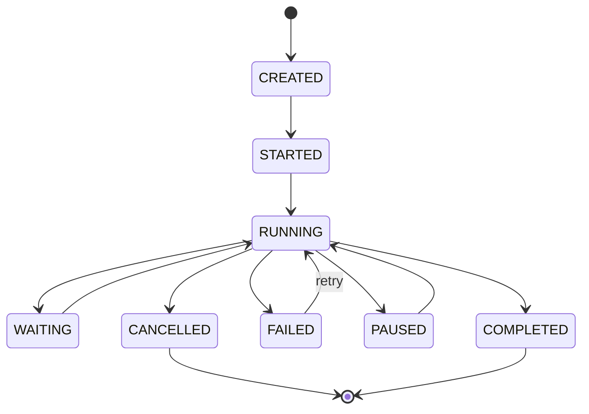

# Technical Specification

## System Architecture

Frontend

- Next.js
- TypeScript 7.0.2
- React Query
- React Flow
- Tailwind
- Shadcn UI

Backend

- Java 25
- Spring Boot 4.1.1
- Spring Security
- Spring Data JPA
- Spring Modulith

AI Layer

- Python 3.15.0
- FastAPI
- LangGraph
- LangChain
- OpenAI Compatible Models

Infrastructure

- PostgreSQL
- Redis
- Kafka
- MinIO
- OpenSearch

Deployment

- Docker
- Kubernetes
- GitHub Actions
- ArgoCD

---

## Version Compatibility Matrix

| Component | Fixed Version | Compatibility Note |
|---|---|---|
| Java | Java 25 | Compiled with `--release 25` |
| Spring Boot | 4.1.1 | Fixed version |
| Spring Modulith | Latest stable version compatible with Boot 4.1.1 | Managed via Boot BOM |
| Python | Python 3.15.0 | Pinned with `uv` |
| FastAPI | Latest version supporting 3.15 | Pinned with `uv.lock` |
| LangChain / LangGraph | Version verified for 3.15 compatibility | Pinned with `uv.lock` |
| TypeScript | TypeScript 7.0.2 | Native compiler version |
| Node.js | Current LTS | Compatible with TS 7.0.2 + Next.js |
| Next.js | Version compatible with TS 7.0.2 | Pinned with `package-lock.json` |
| React / @types/* | Version compatible with TS 7.0.2 | Verified with `npm run typecheck` |

Mandatory measures against version incompatibility:

- All libraries are selected from their latest stable versions.
- All dependencies are pinned with lock files: Maven BOM (`pom.xml`), `package-lock.json`/`pnpm-lock.yaml`, `uv.lock`.
- Version upgrades are performed only with Renovate/Dependabot + CI verification.
- On every PR: `mvn verify`, `npm run build`, `npm run typecheck`, `uv sync`, and OWASP Dependency Scan are run.
- A PR containing an incompatible version is automatically rejected (CI fail).
- An SBOM is generated for every release.
- Multiple versions of the same library cannot exist in the dependency tree (dependency convergence).
- This matrix is updated on every version change.
- Python 3.15.0 ecosystem risk: Before starting development, a pilot `uv sync` + build/compatibility test of the AI libraries (including C-based dependencies) is performed; detection of incompatible libraries is reported early.
- Spring Boot 4.x compatibility: The third-party Spring ecosystem plugins used (Spring Security, Spring Data, Modulith, Kafka, etc.) are continuously tracked against the Boot 4.1.1 compatibility matrix.

---

## Inter-Service Communication Matrix

| Caller → Target | Method | Channels |
|---|---|---|
| Frontend → Backend | Synchronous REST | `/api/v1/*` |
| Frontend → AI Copilot | Synchronous REST (Backend proxy) | `/api/v1/copilot/*` |
| Backend → AI Layer | Synchronous gRPC (REST fallback) | FastAPI `/ai/*` |
| Workflow Engine → Task Service | Asynchronous Event | `workflow.task.*` topics |
| Workflow Engine → Notification | Asynchronous Event | `notification.send` |
| AI Layer → Backend | Synchronous REST (tool calls) | `/internal/tools/*` |
| All services → Analytics | Asynchronous Event | `analytics.events` |
| External systems → Platform | Synchronous REST (webhook) | `/api/v1/webhooks/*` |

Rule: State-changing inter-service flows must be asynchronous (Kafka); only queries requiring low latency remain synchronous.

---

## Event Driven & Saga Pattern (Distributed Transactions)

- The Outbox Pattern is mandatory for consistency between the transactional operation and event publication.
- The Saga Pattern is used in flows involving multiple services/external systems (ERP, CRM); a compensating transaction is defined for each step.
- Orchestration-based saga is preferred (the Workflow Engine is the saga coordinator); choreography is used if necessary.
- Saga steps must be idempotent and retryable.
- The event schema is managed with Avro + Schema Registry; backward-compatible changes are mandatory.
- Outbox management: The outbox table is partitioned; sent records are cleaned up regularly; the dispatcher reads in batches and uses a separate connection pool (DB I/O load is limited). At high volume, the CDC (Debezium) alternative is evaluated.

---

## Error Handling Standard

- All errors are returned in RFC 7807 Problem Detail format through a central exception handler.
- Format: `type`, `title`, `status`, `detail`, `instance`.
- Error code catalog: `AWAP-<SERVICE>-<CODE>` (e.g. `AWAP-ENG-0001`).
- Domain exceptions are independent of infrastructure.
- Stack traces cannot be leaked to the client.

---

## Idempotency Design

- Every mutating endpoint accepts the `Idempotency-Key` header.
- The key is stored on the server for 24 hours and a repeated request with the same key returns the same response.
- Operation duplication is also prevented at the database level with a unique constraint.
- Kafka consumers are idempotent (reprocessing produces the same result).

---

## Multi-Tenancy Model

- Default isolation: Shared Database + row-level `tenant_id` (JPA filter + PostgreSQL RLS).
- Schema-per-Tenant optional for enterprise customers; Database-per-Tenant is supported for higher-level isolation requests.
- Every table has `tenant_id` (UUID) and a mandatory filter is applied on every query.
- The tenant context is extracted from the incoming request (JWT) and propagated across all layers via ThreadLocal/context.
- Cross-tenant access tests are run automatically.
- Tenant-level rate limiting and resource quota are applied; no tenant can consume another tenant's resources.

---

## AI Layer Boundary

- The AI Layer is a Python (FastAPI) service deployed separately from the Backend.
- The Backend accesses the AI Layer only with a service account and over the internal network.
- Tool calls go from the AI Layer to the Backend with mandatory `Permission Verification`.
- The user's security context (tenant, role, permission) is carried to the AI Layer; the AI cannot exceed this authority.
- Model selection is done through a model-agnostic adapter (OpenAI Compatible + alternative providers).
- Backend ↔ AI Layer communication: gRPC (protobuf) is preferred; REST fallback is used in unsuitable flows.
- The P95 < 300ms target does not apply to synchronous LLM calls; LLM response < 10s is a separate target. Synchronous queries are optimized with cache and async jobs.
- LangGraph handles only agent-internal state management; business process state is only in the Workflow Engine. A clear boundary and event-based synchronization are established between the two state machines (split-brain is prevented).

---

## Rate Limiting

| Target | Limit |
|---|---|
| General API (per user) | 300 requests/min |
| Auth endpoints (per IP) | 10 requests/min |
| AI Copilot (per user) | 20 requests/min |
| AI tool calls (per agent) | 60 requests/min |
| Webhook ingress (per IP) | 120 requests/min |

On breach, `429 Too Many Request` + `Retry-After` header are returned.

Tenant-Level Quota

- Per-tenant quotas are defined for AI agent calls, workflow executions, document volume, and concurrent users.
- On quota breach, the relevant tenant's operations are restricted; other tenants are not affected.
- Quota values are managed according to the tenant plan (`PUT /api/v1/tenants/{id}/limits`).

---

## Secrets Management

- Secrets are managed with Vault/Sealed Secrets.
- Secrets are never written in plain text to code, config, or environment variables.
- Secret rotation policy: API keys and DB passwords are rotated every 90 days.
- Access is granted according to the least privilege principle.

---

## Backup & Disaster Recovery

| Target | Value |
|---|---|
| RPO (data loss tolerance) | ≤ 15 min |
| RTO (recovery time) | ≤ 4 hours |
| PostgreSQL backup | Continuous PITR + daily full backup |
| MinIO | Bucket versioning + cross-region replication |
| Restore drill | Mandatory every 3 months |

---

## CI/CD

- Environments: `dev`, `staging`, `prod`.
- Pipeline: build → unit test → integration test → static analysis → dependency scan → contract test → image build → deploy.
- Deployment strategy: blue-green or canary for `prod`; rollback is automated.
- Prod deployment is performed only through a tagged release.

---

# Modules

## Identity Service

Responsibilities

- Authentication
- Authorization
- RBAC
- SSO
- Tenant Isolation

API

POST /auth/login

POST /auth/logout

POST /auth/refresh

GET /auth/me

Additional APIs

- `POST /api/v1/tenants` — tenant on-boarding
- `GET /api/v1/tenants/{id}` — tenant detail
- `PUT /api/v1/tenants/{id}/limits` — tenant quota management

SSO: OIDC/SAML integration is provided in Phase 3.

---

## Organization Service

Entity

Company

Department

Team

Position

User

Relationships

Company
 └── Department
      └── Team
           └── User

---

## Workflow Definition Service

Purpose

To store workflow templates.

Entity

WorkflowDefinition

WorkflowVersion

NodeDefinition

TransitionDefinition

WorkflowVariable

---

Node Types

START

END

FORM

APPROVAL

TASK

DECISION

CONDITION

SUB_PROCESS

AI_TASK

SCRIPT

WEBHOOK

DELAY

PARALLEL_GATEWAY

MERGE_GATEWAY

---

Workflow JSON Format

```json
{
  "workflowId": "uuid",
  "version": 1,
  "name": "Leave Request",
  "nodes": [
    {
      "id": "n1",
      "type": "START"
    },
    {
      "id": "n2",
      "type": "FORM",
      "formId": "uuid"
    },
    {
      "id": "n3",
      "type": "APPROVAL",
      "approvers": ["role:manager"],
      "timeoutSeconds": 86400
    },
    {
      "id": "n4",
      "type": "END"
    }
  ],
  "edges": [
    { "from": "n1", "to": "n2" },
    { "from": "n2", "to": "n3" },
    { "from": "n3", "to": "n4" }
  ],
  "variables": []
}
```

Expression Language: SpEL (Spring Expression Language) is used in condition and decision nodes; expressions are restricted to whitelisted functions.

---

Acceptance Criteria

- Versioning must be supported
- Draft must be supported
- Publish support is required
- Rollback must be supported

Definition Migration

- A running instance continues with the immutable snapshot of the workflow version it started with.
- New instances always use the latest published version.
- Old versions cannot be deleted; they are soft-deleted/archived.
- When the template is updated, running processes are not affected (they continue with the old version).

---

## Workflow Engine

Entity

WorkflowInstance

ExecutionContext

NodeExecution

TaskInstance

ExecutionLog

State Machine

CREATED

STARTED

RUNNING

WAITING

COMPLETED

FAILED

CANCELLED

PAUSED

State Transition Diagram



Execution Rules

A node is executed only once.

State transitions occur within a transaction.

Workflow replay must be supported.

Workflow recovery must be supported.

Idempotency is mandatory.

The state machine must be deterministic: the same input + the same event order always produces the same state (mandatory for resuming from where it left off after a crash).

Replay & Recovery Algorithm

- Every node execution is recorded in `ExecutionLog`.
- Recovery: For `FAILED` or `RUNNING` instances, execution continues idempotently from the last successful node.
- Replay: The recorded execution log of an instance is replayed in order to reproduce the state; external calls (webhook, notification) are not repeated during replay (idempotency).

---

## Task Service

Task States

OPEN

ASSIGNED

IN_PROGRESS

REJECTED

APPROVED

COMPLETED

CANCELLED

---

Task Operations

Assign

Claim

Approve

Reject

Reassign

Escalate

Complete

---

Edge Cases

Approval of the same task by two users must be prevented.

Operation duplication must be prevented.

Race conditions must not occur.

Mitigations: Optimistic locking (version field), `Idempotency-Key`, unique constraint for single approval, escalation timeout timers.

---

## Form Service

Field Types

TEXT

TEXTAREA

NUMBER

EMAIL

PHONE

DATE

DATETIME

BOOLEAN

SELECT

MULTI_SELECT

FILE

---

Validation Rules

Required

Min Length

Max Length

Regex

Custom Validation

Server Validation

---

## AI Copilot Service

Capabilities

Workflow Discovery

Workflow Initiation

Task Query

Task Completion

Approval Assistance

Knowledge Search

---

Prompt Inputs

User Context

Tenant Context

Workflow Catalog

Task Catalog

Security Context

---

Tool Definitions

create_workflow_instance

assign_task

find_workflow

get_user

send_notification

search_documents

create_approval

---

Security Requirements

Tenant Isolation

Prompt Injection Protection

Rate Limiting

Audit Logging

Permission Verification

Guardrails (LLM input/output scanning: NeMo Guardrails or equivalent)

---

Human-in-the-Loop (HITL)

- In high-risk AI decisions (e.g. high-budget approval, writes to external systems), the AI cannot complete the operation without asking the user for approval.
- The HITL flow is connected to an APPROVAL node; the AI agent creates a task awaiting approval.
- Human approval is mandatory if the confidence score is below the threshold.
- All HITL approvals are written to the audit log.

Model Routing & Cost Optimization

- Dynamic Model Routing: Simple queries (summarization, classification, small text) are routed to small/cheap models; complex queries (multi-step agent, code, analysis) are routed to large models.
- The routing decision is made policy-based according to the query complexity score, task type, budget limit, and latency requirement.
- Every model call is monitored with cost, token, and latency metrics; tenant-based budget/cap is applied.
- Model fallback: If the primary model fails or exceeds the cost threshold, a cheaper/equivalent model is used.

---

## Notification Service

Channels

Email

Slack

Teams

Web Notifications

Push Notifications

Dead Letter Queue is mandatory.

Retry mechanism is mandatory.

Retry Policy (concrete parameters)

- Maximum attempts: 3
- Backoff: exponential + jitter (1s, 5s, 25s)
- Afterwards it falls to the DLQ; a DLQ consumer and alarm are mandatory.
- The consumer is idempotent (a duplicate notification is not sent when the same message is processed again).

---

## Document Service

File Size

Max 500 MB

Supported Formats

PDF

DOCX

XLSX

PPTX

PNG

JPG

TXT

Security

- Every uploaded file cannot be stored without passing an antivirus/malware scan.
- Files are stored in MinIO with bucket versioning.
- Download access is verified with tenant + resource authorization.

---

## Analytics Service

Metrics

Process Duration

Task Duration

Approval Duration

Success Rate

Failure Rate

Usage Statistics

Data Flow

- All services publish events to the `analytics.events` topic.
- The Analytics service consumes these events and produces metrics.
- Raw data is written to OpenSearch, aggregations are written to PostgreSQL.

OpenSearch Usage Purpose

- Document and information full-text search
- Analytical queries and dashboard aggregations
- Log analysis (observability support)

---

## Webhook & Script Security

Webhook (outgoing)

- HMAC signature is mandatory.
- Outbound allowlist (target whitelist) is mandatory.
- SSRF protection is mandatory.
- Retry + idempotency is applied.

Webhook (incoming)

- HMAC signature verification is mandatory.
- Rate limiting is applied.

SCRIPT Node

- Scripts run inside a sandbox with limited privileges.
- Mandatory timeout (default 10 sec).
- Filesystem and network access are disabled by default.
- Scripts are restricted to whitelisted libraries (RCE risk is prevented).

---

## Kafka Topic Structure

| Topic | Producer | Consumer | Partition Key |
|---|---|---|---|
| `workflow.instance.events` | Workflow Engine | Analytics | workflowInstanceId |
| `workflow.task.events` | Workflow Engine / Task | Analytics | taskInstanceId |
| `notification.send` | All services | Notification | tenantId |
| `analytics.events` | All services | Analytics | tenantId |

- The message schema is managed with Avro (Schema Registry).
- Consumers are idempotent.
- A DLQ is defined for every topic.

---

## API Versioning

- URI-based versioning is used: `/api/v1/...`.
- Breaking changes are prohibited; a new version is opened with a new major version.
- The old version is supported for at least 6 months; an announcement is made at least 2 versions in advance before removal.

---

## Tenant On-Boarding Flow

1. The system administrator creates the tenant with `POST /api/v1/tenants`.
2. Plan/quota and isolation parameters are assigned for the tenant.
3. The tenant admin is created and an invitation is sent.
4. The organizational structure (Company/Department/Team) is set up.
5. The initial process templates are loaded.
6. The tenant is activated; measurements begin.

---

## Non Functional Requirements

Availability

99.9%

Response Time

P95 < 300ms

Workflow Start

< 1 second

Task Query

< 500 ms

AI Response

< 10 seconds

---

## Audit Requirements

All operations must be recorded.

Deleted records must be soft deleted.

The audit log must be immutable.

Every entity must have `created_by` and `updated_by` fields.

Data Lifecycle, Archiving & Purging

- Soft-deleted records are automatically archived or physically deleted at the end of the retention period.
- Tenant-based purging: On tenant deletion or contract termination, the data is first moved to the archive; at the end of the retention period it is irreversibly deleted (right to be forgotten).
- Archiving: Old soft-delete and audit records are moved to cold storage (archive bucket/partition); only active data remains in the hot DB.
- Purging jobs run with scheduled batch jobs, during off-peak hours, and on a tenant basis.
- Deletion operations are idempotent and audited; mandatory verification (retention period check) is performed before physical deletion.

---

## Test Requirements

Unit Coverage

Minimum 80%

Critical Modules

Minimum 95%

Contract Test

Mandatory

Integration Test

Mandatory

E2E Test

Mandatory

Additional Test Requirements

- Concurrency tests are mandatory for race condition scenarios.
- Tenant isolation tests are mandatory.
- Security tests are mandatory for prompt injection scenarios.
- Load test (k6/Gatling) is mandatory before release.
- Distributed transaction tests are mandatory for saga and compensating transaction scenarios.
- End-to-end tests are mandatory for HITL (human-in-the-loop) flows.
